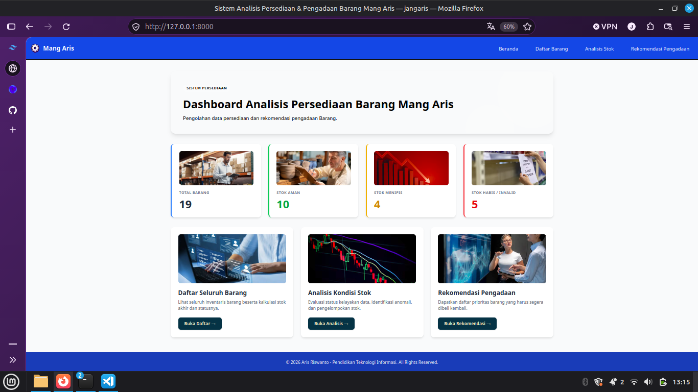
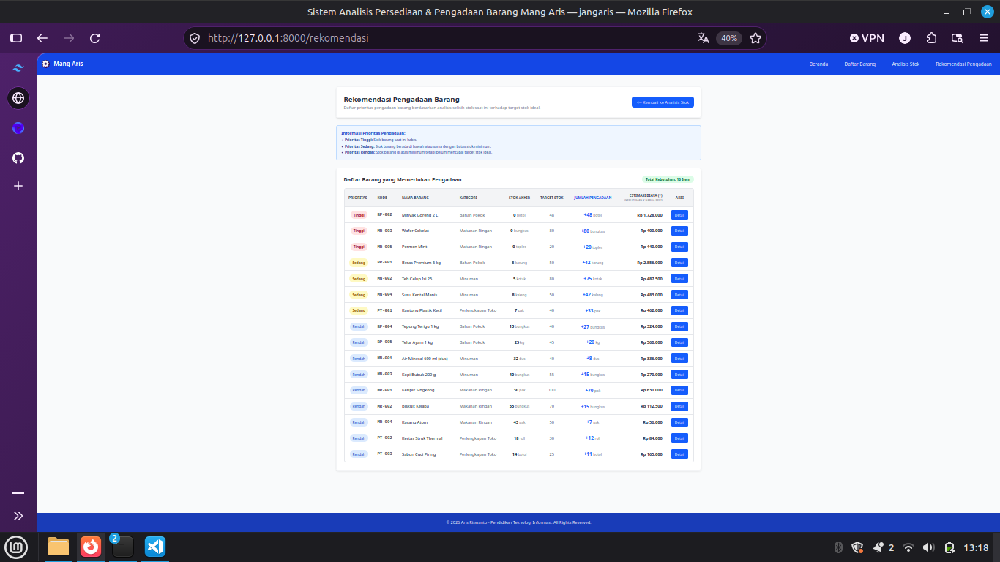

## Identitas Mahasiswa

**Nama:** Aris Riswanto  
**NIM:** C2483207002
**Kelas:** PTI5A
**Program Studi:** Pendidikan Teknologi Informasi  
**Universitas:** Universitas Muhammadiyah Tasikmalaya (UMTAS)

**Mata Kuliah:** Pemrograman Internet  
**Tema Proyek:** Tema 3 – Sistem Analisis Persediaan dan Rekomendasi Pengadaan Barang

## Deskripsi Permasalahan & Solusi

### Permasalahan

Pengelola UMKM sering mengalami kesulitan dalam memantau jumlah persediaan berbagai jenis barang secara akurat. Hal ini menyebabkan beberapa barang sering kehabisan stok secara tiba-tiba karena terlambat dipesan ulang, sementara barang lainnya menumpuk dalam jumlah besar.

### Solusi yang Dikembangkan

Aplikasi web berbasis framework **Laravel** dengan arsitektur **Model-View-Controller (MVC)** tanpa menggunakan database (data disimpan dalam struktur array PHP). Sistem ini mampu menghitung stok akhir secara otomatis, mendeteksi anomali atau data tidak valid, mengelompokkan kondisi stok, serta menyusun daftar prioritas rekomendasi pengadaan barang berdasarkan kebutuhan target stok.

## Implementasi Arsitektur MVC & Routing

1. **Model (`app/Models/Barang.php`):**
   Berperan sebagai penyedia sumber data statis dalam bentuk array PHP yang memuat 19 data item barang dari 4 kategori (_Bahan Pokok_, _Minuman_, _Makanan Ringan_, dan _Perlengkapan Toko_), termasuk beberapa data uji untuk validasi anomali.

2. **Controller (`app/Http/Controllers/PersediaanController.php`):**
   Memuat seluruh logika pemrosesan data, validasi kelayakan input, perhitungan stok akhir, penentuan status persediaan, serta penyusunan prioritas rekomendasi pengadaan barang.

3. **Blade View (`resources/views/`):**
   Menggunakan sistem templating Blade (`@extends`, `@section`, `@yield`, `@foreach`, `@if`) yang dipadukan dengan Tailwind CSS dan Flowbite untuk menyajikan antarmuka yang bersih dan responsif.

4. **Routing (`routes/web.php`):**
   Mengatur navigasi antarhalaman serta memanfaatkan **parameter URL** untuk menyaring daftar barang berdasarkan kategori (`/barang/kategori/{kategori}`) dan menampilkan rincian spesifik per barang (`/barang/detail/{kode}`).

## Logika Perhitungan & Aturan Sistem

### 1. Rumus Perhitungan Stok Akhir

$$
\text{Stok Akhir} = (\text{Stok Awal} + \text{Barang Masuk}) - \text{Barang Keluar}
$$

### 2. Validasi Data Persediaan

Data dikategorikan sebagai **Tidak Valid (Anomali)** apabila memenuhi salah satu kondisi berikut:

- Nilai `stok_awal`, `barang_masuk`, atau `barang_keluar` bernilai negatif ($< 0$).

- Nilai `stok_target` lebih kecil daripada `stok_minimum`.

### 3. Aturan Status Kondisi Stok

- **Habis:** Jika $\text{Stok Akhir} = 0$.

- **Menipis:** Jika $0 < \text{Stok Akhir} \le \text{Stok Minimum}$.

- **Aman:** Jika $\text{Stok Akhir} > \text{Stok Minimum}$.

### 4. Logika Rekomendasi & Prioritas Pengadaan

Barang yang valid dan memiliki $\text{Stok Akhir} < \text{Stok Target}$ akan direkomendasikan untuk pengadaan dengan jumlah:

$$
\text{Kebutuhan Pengadaan} = \text{Stok Target} - \text{Stok Akhir}
$$

Urutan prioritas pengadaan ditentukan berdasarkan kondisi stok akhir:

1. **Prioritas Tinggi:** Barang dengan status **Habis**.

2. **Prioritas Sedang:** Barang dengan status **Menipis**.

3. **Prioritas Rendah:** Barang dengan stok di atas batas minimum.

## Screenshot Aplikasi

### Halaman Beranda



### Halaman daptar semua barang


### Halaman memilih kategori


### Halaman Detail barang


### Halaman analisis barang


### Halaman rekomendasi



## 🚀 Petunjuk Menjalankan Aplikasi di Lokal

Ikuti langkah-langkah berikut untuk menjalankan proyek ini di komputer lokal:

1. **Clone repository ini:**

    ```
    git clone https://github.com/jangaris/UTS-Pemrograman-Internet---Tema-Sistem-Analisis-Persediaan-Aris-Riswanto.git
    cd nama-repository-kamu

    ```

2. **Install dependensi PHP menggunakan Composer:**

    ```
    composer install

    ```

3. **Salin file konfigurasi `.env` dan generate application key:**

    ```
    cp .env.example .env
    php artisan key:generate

    ```

4. **Jalankan server pengembangan lokal Laravel:**

    ```
    php artisan serve

    ```

5. **Buka aplikasi di browser:**
   Akses alamat `http://127.0.0.1:8000` melalui browser Anda.
